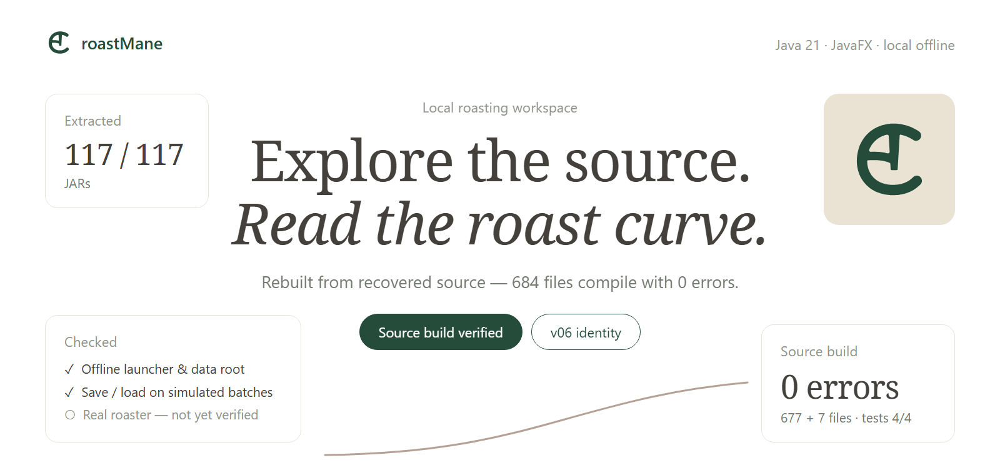
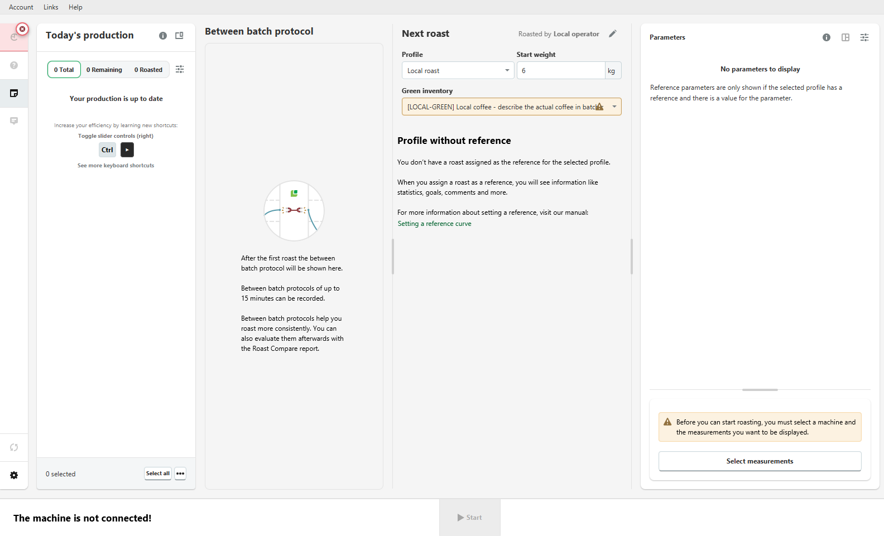

<p align="center">
  
</p>

<p align="center">
  
  
  
  
</p>

<p align="center"><strong>Khám phá mã nguồn. Hiểu đường cong rang. Phát triển theo hướng riêng.</strong><br>
A local roasting workspace, with source recovery in progress.</p>

<p align="center">
  <a href="#roastmane-là-gì">Giới thiệu</a> ·
  <a href="#đã-đủ-source-để-phát-triển-chưa">Trạng thái source</a> ·
  <a href="docs/DEVELOPMENT.md">Bắt đầu phát triển</a> ·
  <a href="docs/ARCHITECTURE.md">Kiến trúc</a> ·
  <a href="docs/ROADMAP.md">Lộ trình</a>
</p>

## roastMane là gì?

**roastMane** là bản desktop thử nghiệm cho công việc rang cục bộ, với nhận diện v06 và môi trường offline. Kho này tập hợp mã khảo sát, bản vá offline, bộ nhận diện v06 và công cụ phục hồi source để tiếp tục phát triển có thể kiểm chứng.

Bản dựng thử nghiệm mới **biên dịch toàn bộ 677 source ứng dụng và 7 source lớp vá trong kho**, không dùng class ứng dụng cũ trên compile classpath. Các thư viện bên thứ ba, JavaFX và runtime vẫn dùng binary dependency như một dự án Java thông thường. Source trích xuất nguyên bản được giữ riêng để đối chiếu.

| Phần việc | Trạng thái thực tế |
|---|---|
| Nhận diện roastMane v06 | Đã tích hợp logo giao diện, cửa sổ và icon EXE |
| Môi trường local offline | Đã kiểm tra launcher, root dữ liệu và chặn socket trong JVM |
| Lưu/đọc mẻ và đường cong | Đã kiểm tra bằng dữ liệu mô phỏng, gồm khởi động lại và nhánh lưu lỗi |
| Kết nối máy rang thật | Chưa kiểm chứng; không suy ra từ smoke test |
| Build ứng dụng và lớp vá từ source | Đạt: 684 file, 0 lỗi; dependency bên thứ ba vẫn dùng binary |

Xem [hồ sơ kiểm thử bản chạy](offline-v06/KIEM-THU.md).

### Giao diện chạy thật



Ảnh từ scene JavaFX thật của bản `-03`, dùng catalog và mẻ mô phỏng trong thư mục tạm. Trạng thái chưa kết nối máy là chủ ý của phép thử; không sử dụng dữ liệu cá nhân. Bản `-03` sửa kích thước vật lý SVG trong thanh bên, giữ nguyên hình logo đã duyệt. Xem [kiểm tra bố cục SVG](docs/BRANDING-QA.md).

## Đã đủ source để phát triển chưa?

**Đã có cây source ứng dụng có thể chỉnh sửa, biên dịch và đóng gói.** Đây vẫn là bản thử nghiệm phục hồi: phép thử hiện có chưa bao phủ mọi tính năng hoặc thiết bị.

Lượt phục hồi ngày 23/10/2026 đã sửa 65 lỗi baseline và 8 lỗi điều khiển `switch` chỉ xuất hiện ở giai đoạn biên dịch tiếp theo. [Báo cáo sửa lỗi và kiểm thử](docs/SOURCE-BUILD.md).

| Mốc kiểm chứng | Kết quả |
|---|---:|
| JAR ứng dụng, thư viện và JavaFX đã xử lý | **117 / 117** |
| Class được kiểm kê | **25.208** |
| File Java trích xuất, gồm biến thể theo phiên bản | **14.223** |
| Class chưa tìm được file nguồn bao ngoài | **0** |
| Source chính và lớp vá biên dịch cùng nhau | **677 + 7 file; 0 lỗi, 11 cảnh báo deprecated** |
| Kiểm thử trên bundle dựng từ source | **Persistence, SVG, UI/FXML và launcher smoke: 4/4 đạt** |

Kiểm kê JAR được thực hiện ngày **22/10/2026**; source build và hồi quy đạt ngày **23/10/2026**, không phải huy hiệu CI tự động. Class lồng nhau được gộp vào file Java bao ngoài. Các thư viện trích xuất chưa được biên dịch lại toàn bộ.

Phát triển tính năng tại **`src/main/java/`**, tài nguyên giao diện tại **`src/main/resources/`**, lớp offline tại **`offline-v06/patch-src/local/`**. Mỗi thay đổi model, biểu đồ hoặc controller cần kiểm tra hành vi tương ứng; compile đạt không chứng minh mọi phương thức tương đương bản nền.

24 file Vineflower báo lỗi có bản đối chiếu CFR; một đoạn `okhttp3/internal/Util` vẫn báo lỗi trong CFR, được bổ sung bằng source Kotlin upstream đúng phiên bản. Native DLL/SO được kiểm kê, **chưa khôi phục mã C/C++**. Runtime JDK và launcher EXE không được coi là source ứng dụng.

→ [Kết quả source build](reports/source-build-20261023.json) · [Baseline lịch sử](reports/BASELINE.md) · [Kiểm toán kho trích xuất](extracted-all/audit.json)

## Bắt đầu

### 1. Lấy mã

```powershell
git clone https://github.com/TCL-DA/roastMane.git
cd roastMane
```

Repo hiện **riêng tư**; tài khoản GitHub phải có quyền truy cập.

### 2. Kiểm tra môi trường và source

Cần Windows, JDK 21, Python 3 và **bundle dependency có sẵn trên máy**. Runtime/bộ cài không được phân phối trong repo. Script có đường dẫn mặc định của máy phát triển; truyền tham số để dùng ở máy khác.

```powershell
# Biên dịch đồng thời main và lớp vá, loại main/overlay JAR cũ khỏi classpath
.\compile-recovered.ps1 -Target Recovered -Bundle 'C:\path\to\roastMane-bundle'
```

Có thể truyền `-JdkBin` để chỉ định thư mục `bin` của JDK. Để tái lập baseline cũ, truyền riêng `-MainSource .\decompiled -Target Main`.

### 3. Đóng gói và kiểm thử bản dựng từ source

```powershell
.\build-from-source.ps1 `
  -BaseBundle 'C:\path\to\roastMane-dependencies' `
  -Output 'C:\Tools\_soi\roastMane-dev'

.\test-recovered.ps1 -Bundle 'C:\Tools\_soi\roastMane-dev'
```

Pipeline biên dịch source, đóng gói class và tài nguyên trong repo, áp nhận diện rồi tạo app-image bằng jpackage. Không lấy class main/overlay cũ để bổ sung những class thiếu. Giữ đầu ra riêng; bộ kiểm thử chỉ dùng dữ liệu tạm. Script `offline-v06/build.ps1` vẫn hỗ trợ cách dựng patch lịch sử, không thay cho source build.

→ [Hướng dẫn phát triển đầy đủ](docs/DEVELOPMENT.md)

## Tìm gì ở đâu?

| Thư mục / tệp | Dùng khi |
|---|---|
| [`src/main/java/`](src/main/java) | Sửa mã ứng dụng đã phục hồi biên dịch |
| [`src/main/resources/`](src/main/resources) | Sửa FXML, CSS và tài nguyên đóng gói |
| [`tests/local/`](tests/local) | Kiểm tra nhánh UI và khởi động ứng dụng thật |
| [`offline-v06/patch-src/local/`](offline-v06/patch-src/local) | Sửa launcher, persistence, môi trường offline và nhận diện |
| [`offline-v06/brand-kit/`](offline-v06/brand-kit) | Lấy logo v06, avatar và bảng màu đã duyệt |
| [`decompiled/`](decompiled) | Đọc baseline ứng dụng chính và source lịch sử |
| [`extracted-all/roastingintelligence-5.13/source/`](extracted-all/roastingintelligence-5.13/source) | Đọc mã trích xuất từ bản v06 hiện hành |
| [`extracted-all/`](extracted-all) | Tra từng thư viện, JavaFX, tài nguyên, SHA-256 và biến thể phiên bản |
| [`tools/`](tools) | Chạy lại trích xuất, đối chiếu và kiểm toán |
| [`reports/`](reports) | Xem lỗi compiler, baseline và số liệu kiểm chứng |
| [`docs/`](docs) | Tìm hướng dẫn phát triển, kiến trúc và lộ trình |

## Bộ nhận diện

Biểu tượng v06 dùng một khối liên tục; bản desktop chủ đạo dùng **xanh lá trầm và be**, bổ sung đen, xám, nâu và trắng. Hình ảnh trong README là đồ họa giới thiệu, không phải biểu đồ đo hoặc ảnh giao diện giả.

<p align="center">
  
  &nbsp;&nbsp;
  
  &nbsp;&nbsp;
  
</p>

→ [Tài sản nhận diện](offline-v06/brand-kit) · [Hướng dẫn đóng góp](CONTRIBUTING.md) · [Báo lỗi](https://github.com/TCL-DA/roastMane/issues/new/choose)
