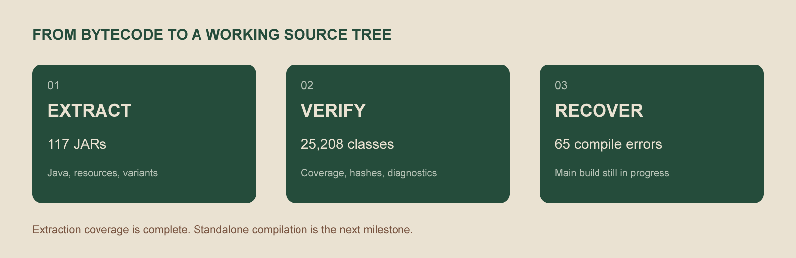

<p align="center">
  
</p>

<p align="center">
  
  
  
  
</p>

<p align="center"><strong>Khám phá mã nguồn. Hiểu đường cong rang. Phát triển theo hướng riêng.</strong><br>
A local roasting workspace, with source recovery in progress.</p>

<p align="center">
  <a href="#roastmane-là-gì">Giới thiệu</a> ·
  <a href="#đã-đủ-source-để-phát-triển-chưa">Trạng thái source</a> ·
  <a href="docs/DEVELOPMENT.md">Bắt đầu phát triển</a> ·
  <a href="docs/ARCHITECTURE.md">Kiến trúc</a> ·
  <a href="docs/ROADMAP.md">Lộ trình</a>
</p>

## roastMane là gì?

**roastMane** là bản desktop thử nghiệm cho công việc rang cục bộ, phát triển từ một bundle Roasting Intelligence 5.13 đã vá. Kho này tập hợp mã khảo sát, bản vá offline, bộ nhận diện v06 và công cụ phục hồi source để tiếp tục phát triển có thể kiểm chứng.

Bản chạy hiện tại sử dụng bytecode nền đã biên dịch cùng launcher và bản vá riêng. **Đây chưa phải ứng dụng được build hoàn toàn từ mã nguồn trong kho.**

| Phần việc | Trạng thái thực tế |
|---|---|
| Nhận diện roastMane v06 | Đã tích hợp logo giao diện, cửa sổ và icon EXE |
| Môi trường local offline | Đã kiểm tra launcher, root dữ liệu và chặn socket trong JVM |
| Lưu/đọc mẻ và đường cong | Đã kiểm tra bằng dữ liệu mô phỏng, gồm khởi động lại và nhánh lưu lỗi |
| Kết nối máy rang thật | Chưa kiểm chứng; không suy ra từ smoke test |
| Build độc lập toàn bộ ứng dụng | Chưa đạt — còn lỗi ở source dịch ngược |

Xem [hồ sơ kiểm thử bản chạy](offline-v06/KIEM-THU.md) và [nguồn gốc](offline-v06/PROVENANCE.md).

### Giao diện chạy thật


Ảnh từ scene JavaFX thật của bản `-03`, dùng catalog và mẻ mô phỏng trong thư mục tạm. Trạng thái chưa kết nối máy là chủ ý của phép thử; không sử dụng dữ liệu cá nhân. Bản `-03` sửa kích thước vật lý SVG trong thanh bên, giữ nguyên hình logo đã duyệt. Xem [kiểm tra bố cục SVG](docs/BRANDING-QA.md).

## Đã đủ source để phát triển chưa?

**Đủ để khảo sát và phát triển lớp vá hiện hành; chưa đủ để sửa tùy ý mọi phần rồi build lại toàn bộ app.**



| Mốc kiểm chứng | Kết quả |
|---|---:|
| JAR ứng dụng, thư viện và JavaFX đã xử lý | **117 / 117** |
| Class được kiểm kê | **25.208** |
| File Java trích xuất, gồm biến thể theo phiên bản | **14.223** |
| Class chưa tìm được file nguồn bao ngoài | **0** |
| Source chính thử biên dịch | **677 file; 65 lỗi trong 23 file** |
| Source phần vá v06 thử biên dịch | **7 file → 15 class; đạt** |

Các số liệu là kết quả kiểm tra ngày **22/10/2026**, không phải huy hiệu CI tự động. Class lồng nhau được gộp vào file Java bao ngoài. Có file tương ứng không chứng minh mọi phương thức được dịch chính xác.

Bạn có thể bắt đầu với **nhận diện, tài nguyên giao diện, launcher và luồng lưu offline**. Với tính năng thay đổi trực tiếp model, biểu đồ hoặc controller chính, cần phục hồi biên dịch phần liên quan và kiểm tra hành vi trước khi tích hợp. Sửa FXML/CSS vẫn cần kiểm tra controller và cách nạp tài nguyên.

24 file Vineflower báo lỗi có bản đối chiếu CFR; một đoạn `okhttp3/internal/Util` vẫn báo lỗi trong CFR, được bổ sung bằng source Kotlin upstream đúng phiên bản. Native DLL/SO được kiểm kê, **chưa khôi phục mã C/C++**. Runtime JDK và launcher EXE không được coi là source ứng dụng.

→ [Kiểm toán độ phủ](extracted-all/audit.json) · [Báo cáo compiler](reports/BASELINE.md) · [Bản đối chiếu](extracted-all/fallback-report.json)

## Bắt đầu

### 1. Lấy mã

```powershell
git clone https://github.com/TCL-DA/roastMane.git
cd roastMane
```

Repo hiện **riêng tư**; tài khoản GitHub phải có quyền truy cập.

### 2. Kiểm tra môi trường và source

Cần Windows, JDK 21, các thư viện JavaFX và **bundle offline nền có sẵn trên máy**. Runtime/bộ cài không được phân phối trong repo. Script có đường dẫn mặc định của máy phát triển; truyền tham số để dùng ở máy khác.

```powershell
# Biên dịch phần vá hiện hành; chưa đóng gói ứng dụng
.\compile-recovered.ps1 -Target OfflineV06 -Bundle 'C:\path\to\roastMane-bundle'

# Tái lập lỗi của mã ứng dụng chính, không dùng main JAR để che lỗi source
.\compile-recovered.ps1 -Target Main -Bundle 'C:\path\to\roastMane-bundle'
```

Có thể truyền `-JdkBin` để chỉ định thư mục `bin` của JDK. Lệnh `Main` hiện dự kiến thất bại với baseline nêu trên.

### 3. Đóng gói bản vá

```powershell
.\offline-v06\build.ps1 `
  -BaseBundle 'C:\path\to\offline-base' `
  -Output 'C:\Tools\_soi\roastMane-dev'
```

Lệnh này **vá bundle nền và đóng gói bằng jpackage**, không biên dịch toàn bộ `extracted-all/`. Giữ đầu ra riêng, thử bằng dữ liệu tạm trước khi sử dụng dữ liệu thật.

→ [Hướng dẫn phát triển đầy đủ](docs/DEVELOPMENT.md)

## Tìm gì ở đâu?

| Thư mục / tệp | Dùng khi |
|---|---|
| [`offline-v06/patch-src/local/`](offline-v06/patch-src/local) | Sửa launcher, persistence, môi trường offline và nhận diện |
| [`offline-v06/brand-kit/`](offline-v06/brand-kit) | Lấy logo v06, avatar và bảng màu đã duyệt |
| [`decompiled/`](decompiled) | Đọc baseline ứng dụng chính và source lịch sử |
| [`extracted-all/roastingintelligence-5.13/source/`](extracted-all/roastingintelligence-5.13/source) | Đọc mã trích xuất từ bản v06 hiện hành |
| [`extracted-all/`](extracted-all) | Tra từng thư viện, JavaFX, tài nguyên, SHA-256 và biến thể phiên bản |
| [`tools/`](tools) | Chạy lại trích xuất, đối chiếu và kiểm toán |
| [`reports/`](reports) | Xem lỗi compiler, baseline và số liệu kiểm chứng |
| [`docs/`](docs) | Tìm hướng dẫn phát triển, kiến trúc và lộ trình |

## Bộ nhận diện

Biểu tượng v06 dùng một khối liên tục; bản desktop chủ đạo dùng **xanh lá trầm và be**, bổ sung đen, xám, nâu và trắng. Hình ảnh trong README là đồ họa giới thiệu, không phải biểu đồ đo hoặc ảnh giao diện giả.

<p align="center">
  
  &nbsp;&nbsp;
  
  &nbsp;&nbsp;
  
</p>

→ [Tài sản nhận diện](offline-v06/brand-kit) · [Hướng dẫn đóng góp](CONTRIBUTING.md) · [Báo lỗi](https://github.com/TCL-DA/roastMane/issues/new/choose)

## Nguồn gốc và quyền sử dụng

Mã dịch ngược không phải source gốc do nhà cung cấp phát hành. Mã gốc và thư viện thuộc chủ sở hữu tương ứng; đổi tên hoặc lưu trong repo không chuyển quyền sở hữu hay cấp quyền phân phối. Giữ thông báo bản quyền, giấy phép và định danh nội bộ cần cho tương thích.

Kho không tự áp giấy phép mã nguồn mở cho toàn bộ nội dung. Đọc [PROVENANCE](offline-v06/PROVENANCE.md) và giấy phép của từng thư viện trước khi phân phối hoặc tái sử dụng. Dữ liệu cá nhân, mẻ rang thật, token và runtime không thuộc bộ bàn giao này.
