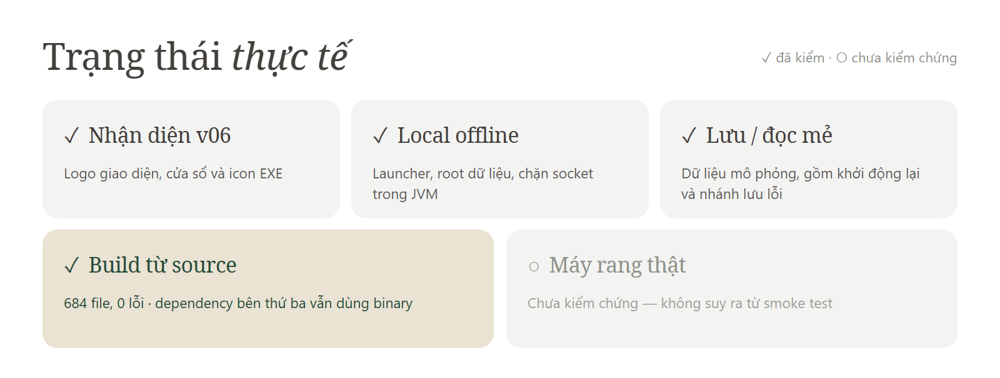
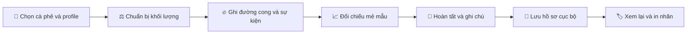

<p align="center">
  
</p>

<p align="center">
  
  
  
  
</p>

<p align="center"><strong>Khám phá mã nguồn. Hiểu đường cong rang. Phát triển theo hướng riêng.</strong><br>
A local roasting workspace, rebuilt from recovered source.</p>

<p align="center">
  <a href="#roastmane-là-gì">Giới thiệu</a> ·
  <a href="#tinh-nang">Toàn bộ nhóm tính năng</a> ·
  <a href="#đã-đủ-source-để-phát-triển-chưa">Trạng thái source</a> ·
  <a href="docs/DEVELOPMENT.md">Bắt đầu phát triển</a> ·
  <a href="docs/ARCHITECTURE.md">Kiến trúc</a> ·
  <a href="docs/ROADMAP.md">Lộ trình</a>
</p>

## roastMane là gì?

**roastMane** là bản desktop thử nghiệm cho công việc rang cục bộ, với nhận diện v06 và môi trường offline. Kho này tập hợp mã khảo sát, bản vá offline, bộ nhận diện v06 và công cụ phục hồi source để tiếp tục phát triển có thể kiểm chứng.

Bản dựng thử nghiệm mới **biên dịch toàn bộ 677 source ứng dụng và 7 source lớp vá trong kho**, không dùng class ứng dụng cũ trên compile classpath. Các thư viện bên thứ ba, JavaFX và runtime vẫn dùng binary dependency như một dự án Java thông thường. Source trích xuất nguyên bản được giữ riêng để đối chiếu.



<details>
<summary>Xem dạng bảng</summary>

| Phần việc | Trạng thái thực tế |
|---|---|
| Nhận diện roastMane v06 | Đã tích hợp logo giao diện, cửa sổ và icon EXE |
| Môi trường local offline | Đã kiểm tra launcher, root dữ liệu và chặn socket trong JVM |
| Lưu/đọc mẻ và đường cong | Đã kiểm tra bằng dữ liệu mô phỏng, gồm khởi động lại và nhánh lưu lỗi |
| Kết nối máy rang thật | Chưa kiểm chứng; không suy ra từ smoke test |
| Build ứng dụng và lớp vá từ source | Đạt: 684 file, 0 lỗi; dependency bên thứ ba vẫn dùng binary |

</details>

Xem [hồ sơ kiểm thử bản chạy](offline-v06/KIEM-THU.md).

### Giao diện chạy thật


Ảnh từ scene JavaFX thật của bản `-03`, dùng catalog và mẻ mô phỏng trong thư mục tạm. Trạng thái chưa kết nối máy là chủ ý của phép thử; không sử dụng dữ liệu cá nhân. Bản `-03` sửa kích thước vật lý SVG trong thanh bên, giữ nguyên hình logo đã duyệt. Xem [kiểm tra bố cục SVG](docs/BRANDING-QA.md).

<a id="tinh-nang"></a>

## ☕ Từ hạt xanh đến hồ sơ mẻ rang

**Chuẩn bị → Theo dõi → Đối chiếu → Hoàn tất → Lưu lại.** roastMane tập hợp công cụ theo dõi rang trên desktop, cùng các mô-đun nâng cao còn trong source để tiếp tục phát triển.



### Bản đồ tính năng — đọc đúng trạng thái

| Ký hiệu | Ý nghĩa |
|---|---|
| ✅ **Đã kiểm thử** | Có phép thử chọn lọc bằng dữ liệu mô phỏng; chỉ xác nhận phạm vi nêu trong mục |
| 🧩 **Có source** | Có triển khai trong cây ứng dụng; chưa xác nhận toàn bộ luồng trên bundle hiện tại |
| 🔌 **Cần thiết bị** | Cần driver, cấu hình và kiểm thử phần cứng; chưa thử máy rang thật |
| 🔐 **Có điều kiện** | Phụ thuộc quyền/module hoặc dữ liệu có sẵn; catalog offline mặc định không cấp đầy đủ |
| ⛔ **Offline không hỗ trợ** | Bị tắt, bị chặn mạng hoặc API local chủ động từ chối |

Đây là **danh mục chức năng tìm thấy qua đối chiếu source**, gồm cả phần bị tắt. Không có tuyên bố “100% tính năng đã chạy ổn”. Chi tiết phạm vi và cách duy trì nằm trong [hồ sơ danh mục](docs/FEATURE-CATALOG.md); [chỉ mục toàn bộ source](docs/SOURCE-INDEX.md) giúp tra tiếp từng thành phần.

| Không gian làm việc | Có gì bên trong? | Đọc chi tiết |
|---|---|---|
| 🌱 Trước mẻ rang | Máy, profile, lô xanh, thành phần, khối lượng, lịch | Nhóm 01–02 |
| 🔥 Trong mẻ rang | Đường cong, RoR, sự kiện, cảnh báo, reference, replay | Nhóm 03–08 |
| 📦 Sau mẻ rang | Hao hụt, chất lượng, lịch sử, thống kê, nhãn | Nhóm 09–12 |
| 🔌 Thiết bị và mở rộng | Nguồn đo, điều khiển, Goals, Tasks, blend | Nhóm 13–16 |
| 🛠️ Cá nhân hóa và dữ liệu | Cấu hình, phím tắt, lưu local, chẩn đoán | Nhóm 17–19 |

<details open>
<summary><strong>🌱 01 · Chuẩn bị mẻ — đúng máy, đúng hạt, đúng khối lượng</strong></summary>

**🧩 Có source; catalog mặc định có máy, profile và lô mẫu để bắt đầu.**

| Chức năng | Cách phục vụ công việc |
|---|---|
| Chọn máy rang | Gắn phiên rang với máy và nhóm làm việc trong catalog |
| Chọn người rang | Ghi người vận hành trong hồ sơ mẻ |
| Chọn profile | Chuẩn bị công thức rang, ghi chú và mẻ tham chiếu liên quan |
| Chọn lô cà phê xanh | Chọn nguyên liệu cho từng thành phần của profile |
| Profile nhiều thành phần | Phân bổ nguyên liệu theo tỷ lệ thành phần được định nghĩa |
| Khối lượng đầu mẻ | Nhập lượng nạp và tính khối lượng theo thành phần |
| Tỷ lệ profile | Hiển thị tỷ lệ thành phần để đối chiếu công thức |
| Kiểm tra đầu vào | Cảnh báo thiếu profile, thiếu lô hoặc khối lượng không hợp lệ |
| Kiểm tra công suất máy | Cảnh báo khi khối lượng nạp vượt sức chứa được khai báo |
| Kiểm tra lượng khả dụng | So sánh khối lượng yêu cầu với dữ liệu lô khi có quản lý tồn |
| Thay lô tự động | Có tùy chọn thay lô nguyên liệu; cần kiểm tra với catalog thực tế |

**Lưu ý local:** lô mẫu để `weight = null`, được hiểu là không giới hạn kiểm tra lượng khả dụng; đây không phải tồn kho vô hạn thực tế. Chưa có trình biên tập catalog hoàn chỉnh được xác nhận.

Nguồn: [PreparationPanel](src/main/java/com/cropster/roastingintelligence/ui/layout/PreparationPanel.java) · [OfflineBootstrap](offline-v06/patch-src/local/OfflineBootstrap.java).

</details>

<details>
<summary><strong>📅 02 · Lịch rang và tổ chức sản xuất</strong></summary>

**🧩 Có source và API lưu local; luồng lịch sản xuất chưa kiểm thử đầu cuối.**

| Chức năng | Chi tiết |
|---|---|
| Đọc lịch theo máy | Lọc kế hoạch dựa trên mã máy |
| Chuẩn bị từ kế hoạch | Có model lịch và liên kết với công việc rang |
| Cập nhật mục đã lên lịch | Ghi lại trạng thái mục lịch vào `state/schedules.json` |
| Liên kết kết quả rang | Gắn lô đã rang với mục lịch tương ứng |
| Danh sách sản xuất | Sidebar trình bày mẻ và thông tin sản xuất |
| Giới hạn số mẻ hiển thị | Tùy chọn `maxRoastCount` để quản lý danh sách gần đây |

Không có đồng bộ lịch từ cloud trong bản offline; API đọc/ghi JSON không đồng nghĩa đã có đầy đủ màn hình tạo lịch mới.

Nguồn: [ProductionSidebar](src/main/java/com/cropster/roastingintelligence/ui/layout/ProductionSidebar.java) · [OfflineConnection](offline-v06/patch-src/local/OfflineConnection.java).

</details>

<details>
<summary><strong>🔥 03 · Phiên rang trực tiếp và đồng hồ</strong></summary>

**🧩 Có source; ✅ launcher và mẻ mô phỏng đã được smoke test. 🔌 Thu thập thật cần phần cứng.**

| Chức năng | Chi tiết |
|---|---|
| Vòng đời mẻ | Chuẩn bị, bắt đầu, đang rang, dừng, hoàn tất và lưu |
| Bắt đầu thủ công | Khởi động ghi mẻ từ giao diện/phím tắt |
| Force start | Có nhánh bắt đầu cưỡng bức theo trạng thái ứng dụng |
| Tự nhận biết mẻ | Tùy chọn phát hiện dựa trên biến thiên nhiệt độ và ngưỡng |
| Tự bắt đầu | Có cấu hình auto-start riêng với auto-detection |
| Dừng mẻ | Kết thúc giai đoạn ghi và chuyển sang thông tin hoàn tất |
| Xác nhận dừng | Tùy chọn hộp xác nhận trước khi dừng |
| Hủy mẻ | Nhánh abort cho phiên đang thực hiện |
| Đồng hồ rang | Kiểu hiển thị thời gian cấu hình được |
| Đồng hồ phát triển/modulation | Có các kiểu timer và tỷ lệ thời gian phát triển |
| Đổi profile trong mẻ | Có luồng đổi profile khi đang theo dõi |
| Theo dõi nhiều kênh | Mỗi kênh có tên, nguồn, đơn vị và trạng thái |
| Giá trị hiện thời | Readout hiển thị giá trị đo bên cạnh biểu đồ |

Nguồn: [JavaFxController](src/main/java/com/cropster/roastingintelligence/ui/JavaFxController.java) · [RoastingModel](src/main/java/org/cropster/roastingintelligence/RoastingModel.java).

</details>

<details>
<summary><strong>📈 04 · Biểu đồ, nhiệt độ và RoR</strong></summary>

**🧩 Có source; ✅ lưu/đọc điểm đường cong được kiểm thử bằng dữ liệu mô phỏng.**

| Chức năng | Chi tiết |
|---|---|
| Đường nhiệt hạt BT | Kênh `beanTemperature`, cơ sở cho nhiều phép đối chiếu |
| Đường nhiệt khí ET | Kênh `exhaustTemperature`; catalog local mặc định có BT/ET |
| Kênh đo bổ sung | Nhiệt đầu vào, trống, đầu đốt, ống khói và các phép đo tùy nguồn |
| RoR theo kênh | Tính tốc độ thay đổi cho kênh hỗ trợ RoR |
| Cửa sổ RoR | Cấu hình khoảng tính thay đổi nhiệt độ |
| Làm mượt RoR | Chọn chế độ smoothing để điều chỉnh đường biểu diễn |
| Giới hạn trục nhiệt | Chỉnh nhiệt độ thấp nhất/cao nhất |
| Giới hạn trục RoR | Chỉnh miền hiển thị tốc độ tăng nhiệt |
| Miền thời gian | Chỉnh khoảng thời gian biểu đồ |
| Phóng to biểu đồ | Có thao tác chuột kết hợp phím bổ trợ |
| Đặt lại khung nhìn | Phím tắt reset chart |
| Tọa độ con trỏ | Đọc vị trí trên đồ thị để đối chiếu điểm thời gian/giá trị |
| Màu và thứ tự kênh | Sắp xếp measurements, tùy chỉnh hiển thị/readout |
| Hiện trạng thái gọn | Tùy chọn condensed channel status |

Nguồn: [CurveChart](src/main/java/org/cropster/roastingintelligence/ui/chart/CurveChart.java) · [chart wrappers](src/main/java/com/cropster/roastingintelligence/ui/chart) · [Preferences](src/main/java/com/cropster/roastingintelligence/Preferences.java).

</details>

<details>
<summary><strong>📍 05 · Sự kiện và ghi chú trên đường rang</strong></summary>

**🧩 Có source.**

| Chức năng | Chi tiết |
|---|---|
| Mốc nạp hạt | Gắn thời điểm CHARGE với mẻ |
| Mốc kết thúc sấy | Đánh dấu DRY_END |
| Mốc nổ lần một | Đánh dấu FIRST_CRACK để phục vụ thời gian phát triển |
| Mốc xả hạt | Đánh dấu DROP |
| Turning point | Có xử lý điểm đảo chiều nhiệt độ trong model/replay |
| Bình luận thủ công | Ghi nội dung gắn với quá trình rang |
| Bình luận theo nhiệt | Có tùy chọn commenting by temperature |
| Đánh dấu tự động | Tùy chọn event auto-marking; chưa kiểm thử trên máy thật |
| Color Change / Second Crack | Có các mốc sự kiện bổ sung trong giao diện; danh sách mẫu local không bao gồm mọi mốc |
| Tùy biến danh sách sự kiện | Chọn mục xuất hiện ở biểu đồ, sidebar và popup riêng biệt |
| Điền sẵn thông số | Có prefill cho gas/airflow |
| Lịch sử comment mẻ mẫu | Cho phép ẩn/hiện trong đối chiếu |
| Gas thành comment | Có ngưỡng chuyển thay đổi gas thành ghi chú |

Nguồn: [CommentsSidebar](src/main/java/com/cropster/roastingintelligence/ui/layout/CommentsSidebar.java) · [CommentsCustomizationTable](src/main/java/com/cropster/roastingintelligence/ui/layout/CommentsCustomizationTable.java) · [Preferences](src/main/java/com/cropster/roastingintelligence/Preferences.java).

</details>

<details>
<summary><strong>🎯 06 · Mẻ mẫu và đối chiếu profile</strong></summary>

**🧩 Có source; 🔐 thao tác đánh dấu mẻ mẫu phụ thuộc quyền.**

| Chức năng | Chi tiết |
|---|---|
| Tải reference | Đọc hồ sơ mẻ được liên kết với profile |
| Biểu đồ tham chiếu | Hiển thị đường mẻ mẫu trong không gian đối chiếu |
| Xem thống kê mẻ mẫu | Đối chiếu thời gian, thông số và ghi chú |
| Ghi chú profile | Hiển thị chỉ dẫn công thức bên cạnh dữ liệu mẻ |
| Smart goals/references | Có công tắc chung điều khiển hiển thị hỗ trợ |
| Đánh dấu reference | API local cập nhật profile và thời điểm thay đổi; giao diện vẫn kiểm tra quyền `markReference` |

Catalog mặc định không cấp quyền đánh dấu reference; không quảng bá thao tác này như sẵn dùng ngay.

Nguồn: [ReferenceChartPanel](src/main/java/com/cropster/roastingintelligence/ui/layout/ReferenceChartPanel.java) · [StatisticsPanel](src/main/java/com/cropster/roastingintelligence/ui/layout/StatisticsPanel.java) · [quyền](src/main/java/com/cropster/roastingintelligence/ui/PermissionNotificationController.java).

</details>

<details>
<summary><strong>▶️ 07 · Replay điều khiển theo mẻ mẫu</strong></summary>

**🔌 Có triển khai điều khiển; chưa kiểm thử phần cứng. Replay có thể phát lệnh ra thiết bị.**

| Chức năng | Chi tiết |
|---|---|
| Dựng kịch bản từ đường mẻ | Đọc các thời điểm giá trị điều khiển thay đổi trong mẻ mẫu |
| Trigger nhiệt độ/thời gian | Đối chiếu đường BT với thay đổi thông số |
| Bỏ giá trị lặp liên tiếp | Chỉ giữ những lần mức điều khiển thực sự thay đổi |
| Bắt đầu/tạm ngừng replay | Có trạng thái replay và paused |
| Điều kiện khởi chạy | Cần reference tương ứng, control đã cấu hình và nguồn hỗ trợ `MeasurementReaderWriter` |
| Điều chỉnh slider khi replay | Các handler phối hợp điều khiển tự động/thủ công |
| Turning point trong replay | Theo dõi điểm đảo chiều để xử lý tiến trình |
| Công tắc bật replay | Có tùy chọn trong Smart Preferences |

Đây không phải cam kết rang tự động đã an toàn hoặc đã xác thực với OTL; nguồn đo phải hỗ trợ ghi và được cấu hình đúng.

Nguồn: [RoastReplayer](src/main/java/com/cropster/roastingintelligence/task/RoastReplayer.java) · [control handlers](src/main/java/com/cropster/roastingintelligence/ui/handler/measurement).

</details>

<details>
<summary><strong>🔔 08 · Cảnh báo và nhắc sự kiện</strong></summary>

**🧩 Có source; chưa kiểm thử đầy đủ từng loại cảnh báo.**

| Chức năng | Chi tiết |
|---|---|
| Cảnh báo theo sự kiện | Nhóm `EVENT_BASED` |
| Cảnh báo theo phép đo | Nhóm `MEASURE_BASED` |
| Hướng vượt ngưỡng | Model có hướng mục tiêu để xác định điều kiện kích hoạt |
| Trình chỉnh cảnh báo | Editor và sidebar cho cấu hình/hiển thị |
| Toast cảnh báo | Tùy chọn thông báo nổi trong ứng dụng |
| Âm thanh sự kiện | Bật/tắt âm báo khi sự kiện xảy ra |
| Âm lượng và lặp âm | Điều chỉnh mức phát và số lần lặp |
| Nhắc theo thời gian/highlight | Có xử lý nhắc theo thời điểm và đánh dấu nổi bật trong UI |
| Dừng âm đang phát | Phím Escape có nhánh dừng SoundManager |
| Lưu cấu hình local | API lưu/đọc `preferences/alarms.json` |

Nguồn: [AlarmServiceImpl](src/main/java/com/cropster/roastingintelligence/service/impl/AlarmServiceImpl.java) · [AlarmEditor](src/main/java/com/cropster/roastingintelligence/ui/components/AlarmEditor.java) · [AlarmController](src/main/java/com/cropster/roastingintelligence/ui/AlarmController.java).

</details>

<details>
<summary><strong>⚖️ 09 · Hoàn tất mẻ và thông số sau rang</strong></summary>

**🧩 Có source; ✅ lưu hồ sơ/đường cong và sửa hồ sơ đã được kiểm thử chọn lọc.**

| Chức năng | Chi tiết |
|---|---|
| Khối lượng sau rang | Ghi lượng thành phẩm và cập nhật lô đã rang |
| Hao hụt khối lượng | Tính/hiển thị weight loss từ dữ liệu đầu/cuối |
| Tổng thời gian | Tóm tắt độ dài phiên rang |
| Thời gian phát triển | Dữ liệu development time dựa trên mốc liên quan |
| Tỷ lệ phát triển | Đối chiếu development time ratio |
| Chỉ số màu rang | Hai trường `roastValue`/`roastValue2`, đơn vị cấu hình được |
| Ghi chú cuối mẻ | Giữ thông tin bổ sung cùng hồ sơ |
| Hiệu chỉnh thời gian | Sửa đầu/cuối mẻ; có cảnh báo khi thao tác cắt bỏ điểm đường cong/comment ngoài khoảng |
| Lưu và cập nhật | API start/finish/update hồ sơ cục bộ |

Nguồn: [FinishPanel](src/main/java/com/cropster/roastingintelligence/ui/layout/FinishPanel.java) · [StatisticsPanel](src/main/java/com/cropster/roastingintelligence/ui/layout/StatisticsPanel.java) · [OfflinePersistence](offline-v06/patch-src/local/OfflinePersistence.java).

</details>

<details>
<summary><strong>🧪 10 · Chất lượng, cupping và phân tích vật lý</strong></summary>

**🧩 Trình bày dữ liệu có sẵn; chưa có luồng nhập/đánh giá chất lượng hoàn chỉnh được xác nhận.**

| Chức năng | Chi tiết |
|---|---|
| Hiển thị phân tích cupping | Đọc bản phân tích gần nhất từ dữ liệu catalog |
| Điểm tổng | Trình bày final score |
| Mô tả hương vị | Hiển thị descriptors |
| Nhận xét phân tích | Hiển thị comments đi kèm |
| Độ ẩm | Trình bày moisture trong phân tích vật lý |
| Hoạt độ nước | Trình bày water activity |
| Khối lượng riêng | Trình bày density |

Local không tự tạo kết quả xét nghiệm hoặc đồng bộ cupping; hai API phân tích hiện đọc cùng map `data.analyses`.

Nguồn: [QualityPanel](src/main/java/com/cropster/roastingintelligence/ui/layout/QualityPanel.java) · [OfflineConnection](offline-v06/patch-src/local/OfflineConnection.java).

</details>

<details>
<summary><strong>📚 11 · Lịch sử và nhật ký giữa hai mẻ</strong></summary>

**🧩 Có source; ✅ archive đọc lại sau khởi động đã kiểm thử.**

| Chức năng | Chi tiết |
|---|---|
| Archive từng mẻ | Hồ sơ JSON lưu theo ID trong `roasts/` |
| Danh sách gần đây | Nạp mẻ đã lưu vào production panel |
| Lọc/chọn nhiều mẻ | Production sidebar có chọn hàng loạt và thao tác theo lựa chọn |
| Sửa final values | Có luồng chỉnh thông số cuối mẻ từ danh sách sản xuất |
| Đọc lại processing record | Tìm reference hoặc archive theo mã lô |
| Nhận diện mẻ | ID, tên lô, ngày giờ, máy, người rang và profile |
| Xem trước đường cong | Có nút preview từ thống kê |
| Nhật ký giữa mẻ | Model và biểu đồ BetweenBatch theo dõi giai đoạn giữa các mẻ |
| Gắn nhật ký với mẻ kế tiếp | Lưu theo `nextBatch` và đọc theo danh sách ID |
| Bật/tắt protocol | Tùy chọn between-batch protocol |
| Dừng ghi giữa mẻ | Có nhánh điều khiển riêng trong giao diện |
| Khởi động lại log giữa mẻ | Có thao tác restart; giao diện nêu giới hạn ghi tối đa 15 phút |

Nguồn: [BetweenBatchPanel](src/main/java/com/cropster/roastingintelligence/ui/layout/BetweenBatchPanel.java) · [BetweenBatchChartWrapper](src/main/java/com/cropster/roastingintelligence/ui/chart/BetweenBatchChartWrapper.java) · [OfflineConnection](offline-v06/patch-src/local/OfflineConnection.java).

</details>

<details>
<summary><strong>🏷️ 12 · Nhãn mẻ và in ấn</strong></summary>

**🧩 Có source; chưa thử máy in thật.**

| Chức năng | Chi tiết |
|---|---|
| Nhãn nhận diện mẻ | Tên/mã lô và ngày rang |
| Nguyên liệu trên nhãn | Các lô xanh và thành phần |
| Thông tin sản xuất | Máy, người rang, profile |
| Thông số mẻ | Thời lượng, khối lượng, chỉ số màu và ghi chú |
| Tùy biến trường nhãn | Ánh xạ nội dung theo label mapping |
| Kiểu nhãn và cỡ chữ | Chọn label style, font size, hiện/ẩn tiêu đề |
| Định dạng ngày | Các lựa chọn DateFormatter |
| QR code | Chọn vị trí; dữ liệu QR được tạo từ URL hồ sơ, không bảo đảm URL hoạt động offline |
| Cửa sổ in | Có hộp thoại ứng dụng và chuyển sang hộp thoại in hệ thống |

Không có bằng chứng xuất PDF/CSV phổ quát cho mẻ trong lượt kiểm kê này; không gộp chức năng in thành tính năng xuất file chưa xác nhận.

Nguồn: [RoastLabel](src/main/java/com/cropster/roastingintelligence/ui/components/RoastLabel.java) · [PrintWindowController](src/main/java/com/cropster/roastingintelligence/ui/layout/PrintWindowController.java) · [PrintPreferencesPage](src/main/java/com/cropster/roastingintelligence/ui/layout/preferences/PrintPreferencesPage.java).

</details>

<details>
<summary><strong>🔌 13 · Nguồn đo, giao thức và connector</strong></summary>

**🔌 Có source; chưa chứng nhận tương thích phần cứng. ⛔ Connector dùng socket mạng bị launcher offline chặn.**

| Họ kết nối | Phạm vi tìm thấy trong source |
|---|---|
| Modbus RTU | Cổng serial, baud, data/stop bits, parity, slave, function, register, kiểu dữ liệu, đơn vị |
| Modbus TCP / UDP | Có factory; không hoạt động qua socket trong launcher offline hiện tại |
| Siemens S7 | Có generic factory; đường mạng chịu cùng giới hạn |
| Phidget | Bridge, temperature, Phidget22, TMP1100/1101/1200, 1132 và networking |
| Cảm biến khác | Pressure, pressure-percent, Yoctopuce, ColorTrack Laser, HubSensor |
| Serial / Network | Có lớp factory dùng chung và implementation theo từng máy |
| Demo / mô phỏng | DemoSource và DeviceSimulator phục vụ nguồn giả lập; không đại diện máy thật |
| Cấu hình kênh | Ánh xạ phép đo, probe, màu, đơn vị, RoR và nguồn dữ liệu |

**Các tên connector theo file source:** Atilla, Autonics TK4S, BellaTW, Berto, Besca Auto/Manual, Buhler PLC, Caparao, Carmomaq, Coffed Serial/Network, CoffeeTech/Network, Coffeetool PLC, Cogen PLC/V2, Diedrich Auto/GasAirflow, Dongyi, DutchMaster, FabricaRoasters, Garanti, Giesen PLC, IMF PLC/V2, IpXenakis PLC, Joper Network, Kapok, KirschUndMausser PLC, Kraffe PLC, Lilla PLC, Loring PLC, MillCity, NordicCoffee, Petroncini, Primo, Probat PLC/SampleRoaster, Rce, Santoker, Schuilenburg PLC, Sivetz PLC, Toper, Typhoon, VortecsPro, Watlow EzZone, YangChia.

Đây là **inventory adapter**, không phải danh sách “cắm là chạy”. Factory trừu tượng cũng không được tính như một thiết bị riêng. Cấu hình local mặc định: RTU 9600 baud, 8N1, function 3, BT slave 1/register 0, ET slave 1/register 1, nhiệt độ °C dạng decimal1/16-bit. Chưa chọn COM và chưa tự mở kết nối; phải đối chiếu thanh ghi thực tế trước khi dùng.

Nguồn: [toàn bộ implementation nguồn đo](src/main/java/org/cropster/roastingintelligence/measurement/impl) · [MeasurementPreferencesPage](src/main/java/com/cropster/roastingintelligence/ui/layout/preferences/MeasurementPreferencesPage.java) · [Launcher](offline-v06/patch-src/local/Launcher.java).

</details>

<details>
<summary><strong>🎛️ 14 · Điều khiển máy và trạng thái vận hành</strong></summary>

**🔌 Có source, phụ thuộc khả năng ghi của thiết bị; chưa kiểm thử lệnh vật lý.**

| Chức năng | Chi tiết |
|---|---|
| Slider điều khiển | Có điều khiển giá trị liên tục cho phép đo/nguồn hỗ trợ |
| Gas/airflow | Có handler và tùy chọn liên quan gas, airflow; khả năng thực tế theo connector |
| Kênh điều khiển bổ sung | Fan speed/drum pressure, drum speed, set temperature hoặc custom tùy nguồn |
| Giới hạn và phát lệnh | Slider dùng min/max từ thiết bị; đường ghi có debounce và chạy nền |
| Nút tăng/giảm | Thao tác trên slider bằng nút và phím |
| Switch trạng thái | Khai báo công tắc/trạng thái điều khiển |
| Control-state bar | Gom các trạng thái đã bật vào thanh thao tác |
| Chế độ manual/auto | Handler riêng cho thao tác tay, tự động và manual measurement |
| Bố trí nút slider | Chọn vị trí control buttons trên/dưới |
| Reset gas threshold | Có cấu hình ngưỡng reset gas |
| Sidebar điều khiển | Tách phần điều khiển khỏi biểu đồ để thao tác |

Phần mềm theo dõi/điều khiển không thay thế liên động an toàn hoặc bộ điều khiển máy. Chưa có bằng chứng bản này điều khiển đầy đủ OTL/STM32.

Nguồn: [MachineControlSidebar](src/main/java/com/cropster/roastingintelligence/ui/layout/MachineControlSidebar.java) · [control components](src/main/java/com/cropster/roastingintelligence/ui/components) · [handlers](src/main/java/com/cropster/roastingintelligence/ui/handler/measurement).

</details>

<details>
<summary><strong>🎯 15 · Goals, độ nhất quán và công việc vận hành</strong></summary>

**🔐 Có source, catalog mặc định thiếu module Goals/Tasks. API local tồn tại không tự mở quyền giao diện.**

| Chức năng | Chi tiết |
|---|---|
| Goal theo đường cong | Loại `CURVE_BASED` |
| Goal theo sự kiện | Loại `EVENT_BASED` |
| Goal theo giá trị | Loại `VALUE_BASED` |
| Nhiệt nạp/xả | Checker cho BT và các kênh nhiệt phụ |
| RoR mục tiêu | RoR, constant RoR, simple RoR 10/15/30/60 giây |
| Nhiệt hạt ổn định | Checker constant bean temperature |
| First crack | Checker mốc nổ lần một |
| Phát triển và thời lượng | Duration, development time, development time ratio |
| Khối lượng và hao hụt | Start/end weight, weight loss |
| Màu và mức điều khiển | Roast value 1/2, gas, airflow và nhiệt môi trường |
| Phạm vi đánh giá | Trong rang, giữa mẻ và sau rang theo checker tương ứng |
| Hiện kết quả | Model trạng thái kiểm tra và thống kê mục tiêu |
| Ẩn số liệu hỗ trợ | Tùy chọn ẩn giá trị goal hiện tại/thống kê |
| Consistency checks | Đọc kết quả kiểm tra lô từ catalog local |
| Tasks theo máy | Đọc/cập nhật `state/tasks.json` |
| Nhóm tác vụ | Có công việc sản xuất, bảo trì, an toàn và trạng thái Done/Won’t Do/comment |
| Tiến độ task | Có model/nhãn cho khối lượng, thời lượng, số lượt và việc một lần; nhánh định dạng đã có test chọn lọc |
| Cấu hình live goals | Lưu/đọc `preferences/live-goals.json` |

Nguồn: [Checkers](src/main/java/com/cropster/roastingintelligence/model/livegoals/Checkers.java) · [LiveGoalController](src/main/java/com/cropster/roastingintelligence/ui/LiveGoalController.java) · [TasksSidebar](src/main/java/com/cropster/roastingintelligence/ui/layout/TasksSidebar.java) · [quyền/module](src/main/java/com/cropster/roastingintelligence/ui/PermissionNotificationController.java).

</details>

<details>
<summary><strong>🌐 16 · Blend, dự đoán và dịch vụ cloud — giới hạn hiện tại</strong></summary>

**⛔ Không hỗ trợ trong bản offline hiện tại. Source giao diện/model được giữ để phát triển tiếp.**

| Chức năng tìm thấy | Hành vi thực tế của lớp offline |
|---|---|
| Dự đoán đường cong | Bootstrap tắt; API ném `UnsupportedOperationException` |
| Dự đoán first crack | Bootstrap tắt; API từ chối |
| Dự đoán flick | Bootstrap tắt; API từ chối |
| Tạo blend thủ công | Có panel, nhưng API local từ chối; còn phụ thuộc quyền blend |
| Tạo blend từ profile | Có panel, nhưng API local từ chối |
| Danh sách blend/profile blend | API local trả danh sách rỗng |
| Đồng bộ tài khoản/cloud | Nút sync bị vô hiệu hóa, socket JVM bị chặn |
| Đăng nhập cloud | Launcher cấu hình Local operator; không tạo phiên xác thực cloud |
| Gửi support ticket | Nút support bị tắt; API local từ chối |
| Mở liên kết trực tuyến | Link/QR không phải dịch vụ local; không bảo đảm truy cập/đích tồn tại |

Nguồn: [OfflineConnection](offline-v06/patch-src/local/OfflineConnection.java) · [OfflineBootstrap](offline-v06/patch-src/local/OfflineBootstrap.java) · [ManualBlendPanel](src/main/java/com/cropster/roastingintelligence/ui/layout/ManualBlendPanel.java) · [BlendWithProfilePanel](src/main/java/com/cropster/roastingintelligence/ui/layout/BlendWithProfilePanel.java).

</details>

<details>
<summary><strong>🎨 17 · Cá nhân hóa không gian làm việc</strong></summary>

**🧩 Có source; nhận diện v06 và giới hạn SVG có kiểm thử riêng.**

| Chức năng | Chi tiết |
|---|---|
| Nhận diện roastMane | Logo sidebar, tiêu đề cửa sổ và icon EXE |
| Locale/ngôn ngữ | Có cấu hình locale và tài nguyên dịch; chưa xác nhận giao diện Việt hóa đầy đủ |
| 11 trang Preferences | General, Units, Interface, RoR, Smart, Chart/comments, Print, Configuration, Measurements, Sliders và Switches |
| Kéo thả bố cục | Đổi thứ tự kênh/control, màu và cỡ readout |
| Kiểm tra cấu hình | Chặn trùng physical channel; một số thay đổi yêu cầu restart; khi đang rang có mục bị khóa |
| Đơn vị đo | Chọn preferred units cho từng nhóm đại lượng |
| Đơn vị màu rang | Cấu hình riêng roast value 1/2 |
| Sidebar tháo rời | Detachable sidebar cho không gian thao tác |
| Cards và panel trượt | Các thành phần hiển thị thông tin theo ngữ cảnh |
| Toàn màn hình | F11 trên Windows; nhánh phím riêng cho macOS trong source |
| Cấu hình biểu đồ | Miền trục, readout, sự kiện và thứ tự kênh |
| Preferences theo máy | Lưu cấu hình riêng từng machine ID |
| Tùy chọn time-lapse | Có cờ cấu hình; chưa xác nhận luồng tạo video hoàn chỉnh, không giới thiệu như chức năng xuất video đã hoạt động |
| Demo ẩn | Có nhánh Shift khi mở Preferences, cần `demo-roast.json`; công cụ thử nghiệm, chưa xác nhận như luồng vận hành chuẩn |
| Hướng dẫn giao diện | Có interface tour, What’s New và trang tra phím tắt |

Nguồn: [Preferences](src/main/java/com/cropster/roastingintelligence/Preferences.java) · [các trang Preferences](src/main/java/com/cropster/roastingintelligence/ui/layout/preferences) · [DetachableSidebar](src/main/java/com/cropster/roastingintelligence/ui/layout/DetachableSidebar.java).

</details>

<details>
<summary><strong>⌨️ 18 · Phím tắt và thao tác nhanh</strong></summary>

**🧩 Có binding trong controller; tác dụng phụ thuộc panel và trạng thái hiện tại.**

| Phím trên Windows | Tác vụ trong source |
|---|---|
| `Ctrl + Enter` | Bắt đầu/force start theo giai đoạn |
| `Shift + Enter` | Dừng mẻ |
| `Ctrl + Esc` | Hủy mẻ |
| `Ctrl + Shift + Enter` | Lưu sau khi dừng |
| `Ctrl + ,` | Mở Preferences |
| `Ctrl + Shift + ,` | Xem danh sách phím tắt |
| `Ctrl + P` | In |
| `Ctrl + R` | Reset biểu đồ |
| `Ctrl + 1…5` | Các thao tác comment/sự kiện theo ngữ cảnh |
| `Ctrl + ← / →` | Thao tác điều khiển theo binding hiện tại |
| `+ / −`, `↑ / ↓` | Tăng/giảm gas khi control tương ứng đang hiện |
| `Ctrl + con lăn` | Thao tác biểu đồ/slider tùy vùng con trỏ |
| `Esc` | Dừng âm báo đang phát |
| `F11` | Toàn màn hình |
| `Ctrl + E` | Xuất tệp log chẩn đoán |
| `Ctrl + S` | Binding đồng bộ còn trong source; không phải lệnh lưu mẻ và không cung cấp cloud offline |

Nguồn: [KeyboardShortcut](src/main/java/com/cropster/roastingintelligence/ui/util/KeyboardShortcut.java) · [JavaFxController](src/main/java/com/cropster/roastingintelligence/ui/JavaFxController.java).

</details>

<details>
<summary><strong>💾 19 · Dữ liệu local, độ tin cậy và chẩn đoán</strong></summary>

**✅ Có kiểm thử chọn lọc cho launcher, lưu/đọc, restart và các nhánh lỗi; 🧩 phần còn lại cần mở rộng kiểm thử.**

| Chức năng | Chi tiết và giới hạn |
|---|---|
| Workspace cục bộ | Mặc định `%USERPROFILE%\roastMane\otl-offline`; hỗ trợ `offline.data` |
| Catalog thống nhất | Bootstrap và connection dùng cùng bộ dữ liệu local |
| Khởi tạo ban đầu | Tạo catalog mẫu nếu chưa có `data.json` |
| JSON hồ sơ mẻ | Ghi metadata, events, curves và thông tin mẻ |
| Giữ ID qua restart | Kiểm thử đọc lại archive và mã mẻ |
| Tách nguyên liệu/kết quả | Archive mẻ không được trộn thành danh sách lô nguyên liệu |
| Kiểm tra timestamp trùng | Từ chối trước khi cấp ID/ghi archive trong nhánh đã kiểm thử |
| Thử lưu lại sau lỗi | Kiểm thử retry và cấp ID liên tục trong tình huống timestamp trùng |
| Ghi qua file tạm | Thay thế file đích bằng atomic move khi hệ thống hỗ trợ; có fallback |
| Không báo lưu thành công giả | Nhánh chỉnh sửa lỗi đã kiểm thử: dữ liệu cũ giữ nguyên, xác nhận lưu bị từ chối |
| Lưu preferences | User, machine, alarms và live goals có API local |
| Lưu state | Lịch và tasks riêng trong thư mục state |
| Log và thông báo hệ thống | System sidebar, trạng thái nguồn và thông báo lỗi trong source |
| Xuất log | Luồng export log files để hỗ trợ chẩn đoán |
| Cô lập dữ liệu kiểm thử | Bộ test dùng thư mục tạm, không lấy dữ liệu rang cá nhân |
| Giới hạn giao dịch | Archive/outbox chưa có transaction chung; không khẳng định mọi lỗi giữa chừng đều tự phục hồi |

Nguồn: [OfflinePersistence](offline-v06/patch-src/local/OfflinePersistence.java) · [OfflineConnection](offline-v06/patch-src/local/OfflineConnection.java) · [kiểm thử persistence](offline-v06/tests/local/PatchedFilePersisterIntegrationTest.java) · [hồ sơ build/test](docs/SOURCE-BUILD.md).

</details>

### 🛠️ Dành cho người muốn phát triển thêm

Ứng dụng có **677 file Java chính, 7 file lớp offline và 291 tài nguyên** trong cây source hiện tại. Có pipeline biên dịch, đóng gói jpackage, tích hợp nhận diện và chạy bốn bộ kiểm thử chọn lọc. Đây là công cụ phát triển và bằng chứng build, tách biệt với chức năng vận hành máy rang ở trên.

→ [Bắt đầu phát triển](docs/DEVELOPMENT.md) · [Kiến trúc](docs/ARCHITECTURE.md) · [Danh mục và giới hạn](docs/FEATURE-CATALOG.md) · [Chỉ mục source](docs/SOURCE-INDEX.md) · [Lộ trình](docs/ROADMAP.md)

## Đã đủ source để phát triển chưa?

**Đã có cây source ứng dụng có thể chỉnh sửa, biên dịch và đóng gói.** Đây vẫn là bản thử nghiệm phục hồi: phép thử hiện có chưa bao phủ mọi tính năng hoặc thiết bị.

Lượt phục hồi ngày 23/10/2026 đã sửa 65 lỗi baseline và 8 lỗi điều khiển `switch` chỉ xuất hiện ở giai đoạn biên dịch tiếp theo. [Báo cáo sửa lỗi và kiểm thử](docs/SOURCE-BUILD.md).


<details>
<summary>Xem dạng bảng</summary>

| Mốc kiểm chứng | Kết quả |
|---|---:|
| JAR ứng dụng, thư viện và JavaFX đã xử lý | **117 / 117** |
| Class được kiểm kê | **25.208** |
| File Java trích xuất, gồm biến thể theo phiên bản | **14.223** |
| Class chưa tìm được file nguồn bao ngoài | **0** |
| Source chính và lớp vá biên dịch cùng nhau | **677 + 7 file; 0 lỗi, 11 cảnh báo deprecated** |
| Kiểm thử trên bundle dựng từ source | **Persistence, SVG, UI/FXML và launcher smoke: 4/4 đạt** |

</details>

Kiểm kê JAR được thực hiện ngày **22/10/2026**; source build và hồi quy đạt ngày **23/10/2026**, không phải huy hiệu CI tự động. Class lồng nhau được gộp vào file Java bao ngoài. Các thư viện trích xuất chưa được biên dịch lại toàn bộ.

Phát triển tính năng tại **`src/main/java/`**, tài nguyên giao diện tại **`src/main/resources/`**, lớp offline tại **`offline-v06/patch-src/local/`**. Mỗi thay đổi model, biểu đồ hoặc controller cần kiểm tra hành vi tương ứng; compile đạt không chứng minh mọi phương thức tương đương bản nền.

24 file Vineflower báo lỗi có bản đối chiếu CFR; một đoạn `okhttp3/internal/Util` vẫn báo lỗi trong CFR, được bổ sung bằng source Kotlin upstream đúng phiên bản. Native DLL/SO được kiểm kê, **chưa khôi phục mã C/C++**. Runtime JDK và launcher EXE không được coi là source ứng dụng.

→ [Kết quả source build](reports/source-build-20261023.json) · [Baseline lịch sử](reports/BASELINE.md) · [Kiểm toán kho trích xuất](extracted-all/audit.json)

## Bắt đầu

### 1. Lấy mã

```powershell
git clone https://github.com/TCL-DA/roastMane.git
cd roastMane
```

Repo hiện **riêng tư**; tài khoản GitHub phải có quyền truy cập.

### 2. Kiểm tra môi trường và source

Cần Windows, JDK 21, Python 3 và **bundle dependency có sẵn trên máy**. Runtime/bộ cài không được phân phối trong repo. Script có đường dẫn mặc định của máy phát triển; truyền tham số để dùng ở máy khác.

```powershell
# Biên dịch đồng thời main và lớp vá, loại main/overlay JAR cũ khỏi classpath
.\compile-recovered.ps1 -Target Recovered -Bundle 'C:\path\to\roastMane-bundle'
```

Có thể truyền `-JdkBin` để chỉ định thư mục `bin` của JDK. Để tái lập baseline cũ, truyền riêng `-MainSource .\decompiled -Target Main`.

### 3. Đóng gói và kiểm thử bản dựng từ source

```powershell
.\build-from-source.ps1 `
  -BaseBundle 'C:\path\to\roastMane-dependencies' `
  -Output 'C:\Tools\_soi\roastMane-dev'

.\test-recovered.ps1 -Bundle 'C:\Tools\_soi\roastMane-dev'
```

Pipeline biên dịch source, đóng gói class và tài nguyên trong repo, áp nhận diện rồi tạo app-image bằng jpackage. Không lấy class main/overlay cũ để bổ sung những class thiếu. Giữ đầu ra riêng; bộ kiểm thử chỉ dùng dữ liệu tạm. Script `offline-v06/build.ps1` vẫn hỗ trợ cách dựng patch lịch sử, không thay cho source build.

→ [Hướng dẫn phát triển đầy đủ](docs/DEVELOPMENT.md)

## Tìm gì ở đâu?

| Thư mục / tệp | Dùng khi |
|---|---|
| [`src/main/java/`](src/main/java) | Sửa mã ứng dụng đã phục hồi biên dịch |
| [`src/main/resources/`](src/main/resources) | Sửa FXML, CSS và tài nguyên đóng gói |
| [`tests/local/`](tests/local) | Kiểm tra nhánh UI và khởi động ứng dụng thật |
| [`offline-v06/patch-src/local/`](offline-v06/patch-src/local) | Sửa launcher, persistence, môi trường offline và nhận diện |
| [`offline-v06/brand-kit/`](offline-v06/brand-kit) | Lấy logo v06, avatar và bảng màu đã duyệt |
| [`decompiled/`](decompiled) | Đọc baseline ứng dụng chính và source lịch sử |
| [`extracted-all/roastingintelligence-5.13/source/`](extracted-all/roastingintelligence-5.13/source) | Đọc mã trích xuất từ bản v06 hiện hành |
| [`extracted-all/`](extracted-all) | Tra từng thư viện, JavaFX, tài nguyên, SHA-256 và biến thể phiên bản |
| [`tools/`](tools) | Chạy lại trích xuất, đối chiếu và kiểm toán |
| [`reports/`](reports) | Xem lỗi compiler, baseline và số liệu kiểm chứng |
| [`docs/`](docs) | Tìm hướng dẫn phát triển, kiến trúc và lộ trình |

## Bộ nhận diện

Biểu tượng v06 dùng một khối liên tục; bản desktop chủ đạo dùng **xanh lá trầm và be**, bổ sung đen, xám, nâu và trắng. Hình ảnh trong README là đồ họa giới thiệu, không phải biểu đồ đo hoặc ảnh giao diện giả.

<p align="center">
  
  &nbsp;&nbsp;
  
  &nbsp;&nbsp;
  
</p>

→ [Tài sản nhận diện](offline-v06/brand-kit) · [Hướng dẫn đóng góp](CONTRIBUTING.md) · [Báo lỗi](https://github.com/TCL-DA/roastMane/issues/new/choose)
