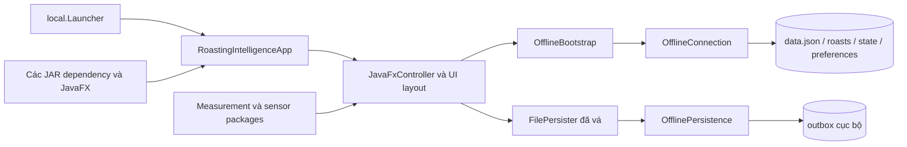
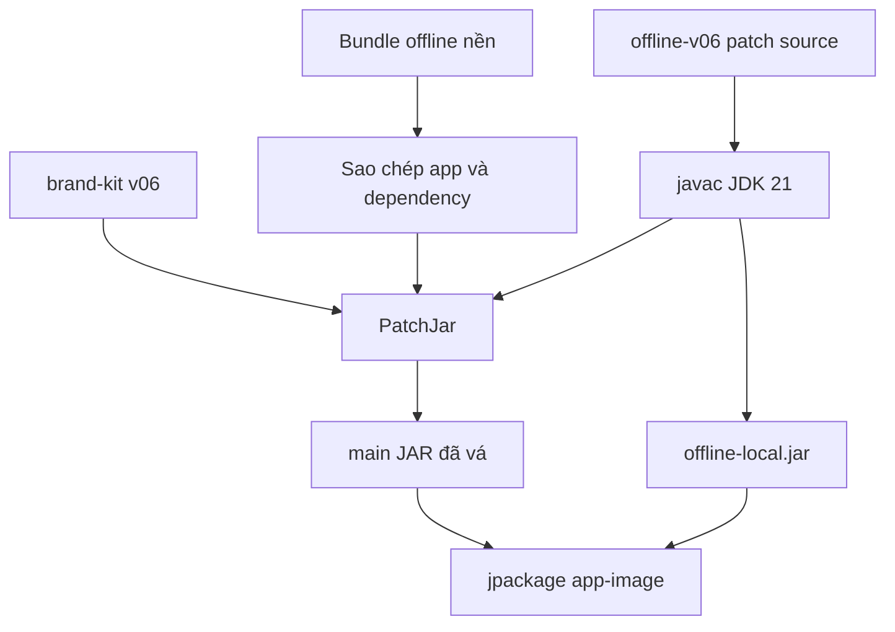

# Kiến trúc roastMane offline

## Mô hình hiện hành



`local.Launcher` thiết lập định danh phiên offline và chặn socket mạng trong JVM trước khi gọi `org.cropster.roastingintelligence.RoastingIntelligenceApp`. `OfflineBootstrap` nạp catalog cục bộ, gắn machine/profile/lot mặc định, tắt dự đoán cần cloud và để source đo ở trạng thái chưa chọn cổng.

## Các lớp chính

### Lớp vá offline v06

Source nằm tại `offline-v06/patch-src/local/`:

- `Launcher.java`: entry point của bundle offline và lớp chặn kết nối mạng.
- `OfflineBootstrap.java`: root dữ liệu, catalog cục bộ, cấu hình model và khởi động UI sau login cục bộ.
- `OfflineConnection.java`: triển khai API cục bộ cho lot, profile, roast archive, state và preferences.
- `OfflinePersistence.java`: lưu outbox nguyên tử, giữ ID bền vững, lưu đủ đường cong và chỉ xác nhận khi file tồn tại, khác rỗng.
- `SmokeProbe.java`: kiểm tra scene graph, root dữ liệu, catalog, mạng và một mẻ QA mô phỏng.
- `PatchJar.java`: vá bytecode/chuỗi/tài nguyên nhận diện trên JAR nền; giữ alias nội bộ cần cho tương thích.
- `BuildIcon.java`: tạo icon Windows đa kích thước từ avatar v06 đã duyệt.

`PatchJar` và `BuildIcon` là công cụ build. Chúng không nằm trong `offline-local.jar` phát hành; JAR này chứa 5 kiểu top-level dùng ở runtime: `Launcher`, `OfflineBootstrap`, `OfflineConnection`, `OfflinePersistence`, `SmokeProbe`, cùng các class lồng nhau do compiler tạo. Lượt biên dịch đã xác minh tạo tổng cộng 15 file `.class`.

### Main application dịch ngược

- `decompiled/org/cropster/roastingintelligence/RoastingIntelligenceApp.java`: JavaFX application và primary stage.
- `decompiled/org/cropster/roastingintelligence/AppModel.java`: trạng thái ứng dụng, dữ liệu, preferences và persister.
- `decompiled/org/cropster/roastingintelligence/RoastingManager.java` và `RoastingModel.java`: vòng đời và trạng thái mẻ rang.
- `decompiled/com/cropster/roastingintelligence/ui/JavaFxController.java`: điều phối UI chính.
- `decompiled/com/cropster/roastingintelligence/ui/layout/`: production sidebar, preparation panel, main panel và cửa sổ preferences.
- `decompiled/org/cropster/roastingintelligence/measurement/` và `sensor/`: nguồn đo, channel và sensor.
- `decompiled/org/cropster/roastingintelligence/service/impl/FilePersister.java`: định dạng outbox JSON được lớp vá persistence chặn tại bytecode.

Hai namespace `org.cropster.*` và `com.cropster.*` cùng tồn tại trong binary gốc. Không gộp hoặc đổi package trước khi có full-source build và phép thử tương thích.

## Dữ liệu cục bộ

Root mặc định:

```text
%USERPROFILE%\roastMane\otl-offline
```

Các nhóm file do overlay quản lý dưới root gồm:

```text
data.json
roasts\<id>.json
state\...
preferences\...
```

Outbox do `FileSystemConfiguration.Directories` cung cấp cho `FilePersister`. `OfflinePersistence` ghi qua file tạm, ép dữ liệu xuống đĩa, rồi move nguyên tử khi filesystem hỗ trợ. Source catalog không tự động di chuyển dữ liệu từ thư mục thương hiệu cũ.

Trong test, `offline.data`, outbox, sent và logs đều trỏ vào thư mục con của `%TEMP%`; vì vậy test không được dùng root mặc định.

## Cách tạo bundle hiện nay



Pipeline này đã tạo bundle chạy được, nhưng không chứng minh `decompiled/` có thể build lại main JAR. Baseline độc lập vẫn còn 65 lỗi compiler.

## Kho trích xuất dependency

`extracted-all/` tách từng JAR thành một thư mục có `source/`, `inventory.json` và `decompiler.log`. `audit.json` ghi nhận 117 JAR, 25.208 class entry, 14.223 Java source và không có outer class chưa ánh xạ. Kết quả đó chỉ chứng minh độ phủ trích xuất; `full_source_build_verified` vẫn là `false`.

Các binary native, runtime JDK và launcher EXE không thể chuyển thành Java source bằng decompiler và không được xem là phần source build độc lập.
