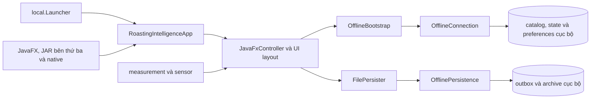
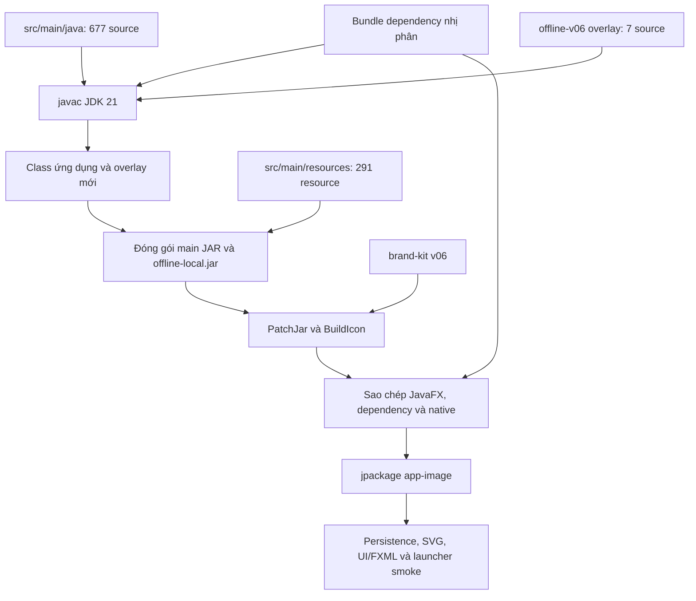

# Kiến trúc roastMane offline

## Tổng quan runtime



`local.Launcher` thiết lập phiên offline và chặn socket mạng trong JVM trước khi gọi `org.cropster.roastingintelligence.RoastingIntelligenceApp`. `OfflineBootstrap` nạp catalog cục bộ, thiết lập machine/profile/lot mặc định, tắt các đường phụ thuộc cloud và không tự chọn cổng đo.

## Source ứng dụng

Source có thể biên dịch nằm dưới `src/main/java/`:

- `org/cropster/roastingintelligence/RoastingIntelligenceApp.java`: JavaFX application và primary stage.
- `org/cropster/roastingintelligence/AppModel.java`: trạng thái ứng dụng, dữ liệu, preferences và persister.
- `org/cropster/roastingintelligence/RoastingManager.java` và `RoastingModel.java`: vòng đời mẻ rang.
- `com/cropster/roastingintelligence/ui/JavaFxController.java`: điều phối giao diện chính.
- `com/cropster/roastingintelligence/ui/layout/`: production, preparation, main panel và preferences.
- `org/cropster/roastingintelligence/measurement/` và `sensor/`: nguồn đo, channel và sensor.
- `org/cropster/roastingintelligence/service/` và `com/cropster/roastingintelligence/service/`: persistence cùng service nội bộ.

Tài nguyên runtime tương ứng nằm tại `src/main/resources/`. Lượt đóng gói hiện hành đưa 291 resource vào main JAR cùng class vừa biên dịch.

Hai namespace `org.cropster.*` và `com.cropster.*` cùng tồn tại trong ứng dụng gốc. Không gộp hoặc đổi package nếu chưa có kế hoạch tương thích binary và migration riêng.

## Overlay offline v06

Source nằm tại `offline-v06/patch-src/local/`:

- `Launcher.java`: entry point offline và chặn kết nối mạng.
- `OfflineBootstrap.java`: root dữ liệu, catalog cục bộ và khởi tạo model.
- `OfflineConnection.java`: API cục bộ cho lot, profile, roast archive, state và preferences.
- `OfflinePersistence.java`: ghi outbox nguyên tử, quản lý ID, archive và xác nhận lưu.
- `SmokeProbe.java`: kiểm tra scene graph, catalog/root, mạng và lưu mẻ mô phỏng.
- `PatchJar.java`: áp dụng nhận diện/tài nguyên v06 lên main JAR vừa dựng.
- `BuildIcon.java`: tạo icon Windows đa kích thước từ avatar đã duyệt.

Năm kiểu runtime đầu tiên được đóng gói vào `offline-local.jar`; `PatchJar` và `BuildIcon` chỉ chạy trong lúc build.

## Pipeline dựng hiện hành



`build-from-source.ps1` điều phối pipeline này. Classpath compile loại `roastingintelligence-5.13.jar` và `offline-local.jar` cũ. Bundle nền chỉ cung cấp dependency; main class không được lấy bù từ binary cũ.

Pipeline vá bytecode/JAR cũ tại `offline-v06/build.ps1` vẫn được giữ để tương thích và truy vết lịch sử. Đường dựng mặc định cho phát triển hiện nay là `build-from-source.ps1`.

## Dữ liệu cục bộ

Root mặc định:

```text
%USERPROFILE%\roastMane\otl-offline
```

Các nhóm dữ liệu gồm catalog, `roasts`, `state`, `preferences`, outbox và archive. Source build không tự động di chuyển dữ liệu từ root thương hiệu cũ.

Trong test, data, home và log đều nằm dưới `%TEMP%`. `OfflinePersistence` hủy xác nhận cũ trước lần ghi sửa đổi, chỉ xác nhận sau khi ghi hoàn tất, và từ chối timestamp trùng trước khi cấp ID hoặc ghi archive. Outbox và archive chưa phải một transaction đa file.

## Dependency và kho lưu trữ

JavaFX, thư viện bên thứ ba, native và JDK runtime vẫn là binary dependency. `extracted-all/` giữ source trích xuất theo từng JAR; `decompiled/` giữ bản ứng dụng thô để đối chiếu bytecode/source. Hai cây này không tham gia source compile mặc định.

Việc dựng thành công 684 source ứng dụng không đồng nghĩa toàn bộ dependency đã được dựng lại. Giấy phép, version, checksum và provenance của dependency phải tiếp tục được giữ khi đóng gói.

Chi tiết bằng chứng nằm trong [SOURCE-BUILD.md](SOURCE-BUILD.md) và [source-build-20261023.json](../reports/source-build-20261023.json).
